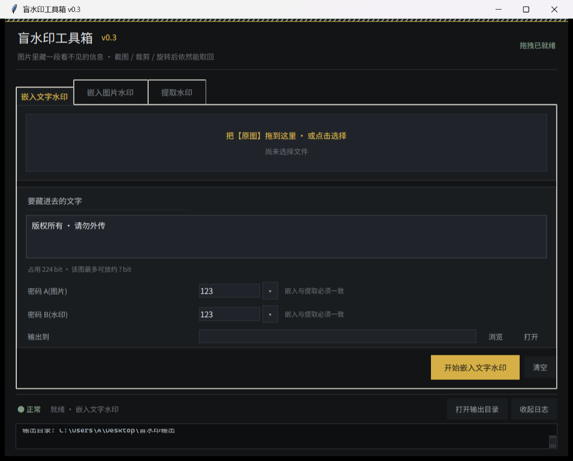
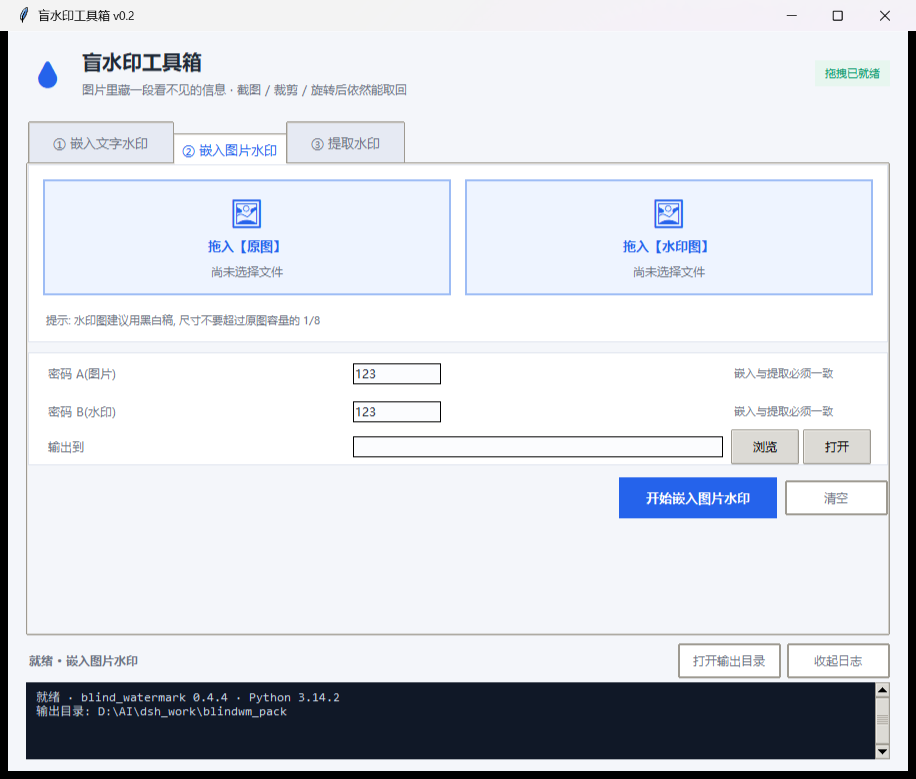
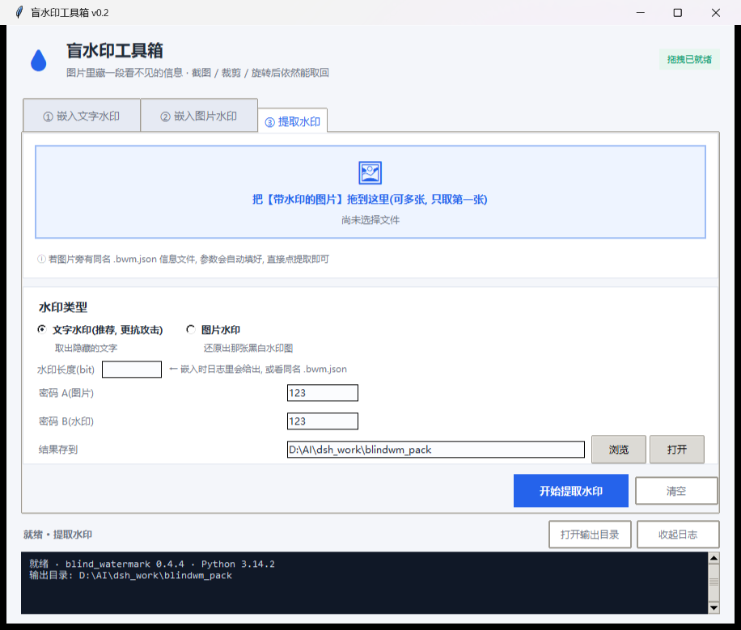

# 盲水印工具箱 (Blind Watermark Toolbox)

> 给 [blind_watermark](https://github.com/guofei9987/blind_watermark) 做的图形界面 + 一键打包成独立 exe 的工程。
> **算法核心完全来自原作者，本仓库只是 GUI 与打包壳。**

---

## ⭐ 原作者与原始项目 (必须先看这里)

本项目的**算法、原理、鲁棒性全部归功于原作者**：

| | |
|---|---|
| **原项目** | [guofei9987/blind_watermark](https://github.com/guofei9987/blind_watermark) |
| **原作者** | **郭飞 (guofei9987)** · guofei9987@foxmail.com |
| **版权** | Copyright (c) 2019 郭飞 · MIT License |
| **PyPI** | [`blind-watermark`](https://pypi.org/project/blind-watermark/) |

如果你要用盲水印，请先去给原项目点个 ⭐，并优先阅读原项目的文档与测试：
原仓库提供了 `att.py`(攻击测试)、`recover.py`(截图/旋转自动校正) 等完整能力。

**本仓库只做了这些事**（不含任何算法创新）：

1. 用 Python 标准库 `tkinter` 做了一套中文图形界面（嵌入文字/嵌入图片/提取 三个独立面板）。
2. 解决了 `cv2.imread` 在 Windows 上**不支持中文路径**的问题（原库直接用 cv2，中文目录会直接失败）。
3. 包了一层**错误密码不崩溃**的容错（原库在密码/长度不匹配时会抛 `ValueError`）。
4. 用 PyInstaller 打包成**单文件免安装 exe**，并处理了 `tkinterdnd2` 原生扩展的打包问题。
5. 加了侧车参数文件、默认输出目录、拖拽载入等易用性细节。

---

## 界面

| ① 嵌入文字水印 | ② 嵌入图片水印 | ③ 提取水印 |
|---|---|---|
|  |  |  |

---

## 功能特性

- **三个面板完全独立**：文字水印、图片水印、提取各自有独立控件与按钮，互不干扰。
- **拖拽载入**：把图片拖进窗口即可（图片水印页连续拖两张 = 原图 + 水印图）。
- **傻瓜化**：每页只有一块拖拽区 + 一个主按钮；密码默认 `123`；实时显示「占用 N bit / 该图最多可放约 M bit」，超容量提前预警。
- **默认输出路径**：自动存到 `桌面\盲水印输出`，文件名自动推导；桌面不可写时逐级回退到文档夹/用户目录。
- **侧车参数文件**：嵌入后自动生成同名 `xxx.bwm.json`（记录版本、密码、水印 bit 长度或尺寸、原文），提取时拖入成品图即自动回填参数 —— 解决「第二天忘了密码/长度提不出来」。
- **中文路径可用**：突破了 cv2 的 ASCII 路径限制。
- **错误密码不崩溃**：给出中文人话提示而不是 traceback。
- **响应式布局**：随窗口缩放自动重排，任意尺寸下主要控件不被裁切。
- **内置自检**：`盲水印工具箱.exe --selftest` 可验证打包产物在目标机上是否真的能用（含拖拽链路）。

---

## 快速开始

### 方式一：直接用打包好的 exe

本仓库**不提交 exe**（构建产物不进 git）。请从右侧 **Releases** 下载，或按下面方式自行构建。

### 方式二：源码运行

```bash
pip install blind-watermark==0.4.4 tkinterdnd2
python bwm_gui.py
```

### 方式三：自行打包成单文件 exe

Windows PowerShell：

```powershell
# 1) 建一个虚拟环境并复用本机已装的 numpy/opencv (省去重新下载几百 MB)
python -m venv --system-site-packages .venv-build

# 2) 安装依赖
.venv-build\Scripts\python.exe -m pip install blind-watermark==0.4.4 pyinstaller tkinterdnd2

# 3) 打包
.venv-build\Scripts\python.exe -m PyInstaller --noconfirm --clean bwm_gui.spec

# 4) 产物 + 自检
.venv-build\Scripts\python.exe dist\盲水印工具箱.exe --selftest
```

也可以直接跑 `scripts\build.ps1`。

打包要点（都已写进 `bwm_gui.spec`）：

- `console=False`：GUI 程序不弹黑框。
- `collect_data_files('tkinterdnd2')`：**tkdnd 是 Tcl 运行时从磁盘加载的原生扩展，必须原样随包分发**，否则打包后拖拽会静默失效。
- `upx=False`：UPX 外壳是杀软误报重灾区，刻意关闭。
- `excludes` 排除 matplotlib/scipy/pandas/PyQt 等，控制体积。

---

## 使用说明

### ① 嵌入文字水印

1. 把原图**拖进窗口**（或点击拖拽区选择）。
2. 输入要隐藏的文字。
3. 密码 A / 密码 B 保持默认 `123` 即可，**但提取时必须完全一致**。
4. 点「开始嵌入文字水印」→ 结果自动存到 `桌面\盲水印输出\原图名_文字水印.png`，并生成同名 `.bwm.json`。

### ② 嵌入图片水印

1. 先拖**原图**，再拖**水印图**（建议用黑白稿，尺寸别超过原图容量的 1/8）。
2. 点「开始嵌入图片水印」。

### ③ 提取水印

1. 把带水印的图片拖进来。
2. 若同目录存在同名 `.bwm.json`，密码/长度/尺寸会**自动填好**，直接点「开始提取水印」。
3. 否则手动填：文字水印填 **bit 长度**，图片水印填 **宽x高**（如 `100x100`）。

---

## 必须知道的算法约束（都源自原项目）

| 约束 | 说明 |
|---|---|
| 容量上限 | 每 4×4 DCT 块藏 1 bit，块数 ≈ `(W/8)×(H/8)`。例：1616×1078 → 约 13,600 bit（1.7 KB）。超出会报「最多可嵌入xx kb信息」 |
| 必须记住水印长度 | 提取时 `wm_shape` 是必填项，忘了就解不出来（本工具的 `.bwm.json` 就是为此） |
| 密码必须成对一致 | `password_img` 与 `password_wm` 在嵌入/提取时必须完全相同 |
| 库版本必须一致 | 编解码要用同一个 blind-watermark 版本，否则可能解不出 |
| 输出必须无损 | JPEG 有损压缩会抹掉水印，请用 PNG/BMP/TIFF（本工具会自动纠正扩展名） |
| 抗攻击范围 | 抗截图、裁剪、旋转、缩放、亮度、椒盐噪声、遮挡等（详见原项目 `att.py`）；微信等有损压缩后的图通常提取失败 |

---

## 项目结构

```
.
├── bwm_gui.py               # 主程序: 三个独立面板 / 拖拽 / 中文路径补丁 / 侧车文件
├── bwm_gui.spec             # PyInstaller 配置(单文件、无黑框、tkdnd 数据收集)
├── bwm_console.spec         # 控制台诊断版配置(排查打包问题用)
├── docs/
│   ├── v0.2-界面优化说明.md      # 本次界面重构的改动、验证记录
│   ├── 打包可行性分析报告.md     # 技术可行性分析(含实测数据)
│   └── screenshots/            # 界面截图
└── scripts/
    ├── build.ps1               # 一键构建 exe
    ├── verify_gui.py           # 算法 + Unicode 路径验证
    ├── gui_flow_test.py        # 模拟用户点击的端到端测试(真实 mainloop)
    ├── layout_check.py         # 响应式布局自动校验
    └── independence_check.py   # 面板独立性与模式切换校验
```

---

## 验证记录

本仓库的代码经过以下实测（详见 `docs/`）：

- 打包产物自检：`SELF_TEST=PASS` —— 文字水印往返一致、图片水印往返相关性 `1.0000`、中文路径读写正常、拖拽链路 `tkdnd drop_target ok`。
- 端到端点击链路：`FLOW_TEST=PASS` —— 拖入 → 自动输出路径 → 嵌入 → 侧车回填 → 提取，图片水印还原相关性 `0.9968`。
- 响应式布局：5 种窗口尺寸 × 3 个标签页 `ALL_FIT=True`。

---

## 已知问题

- exe **未做代码签名**，首次运行会被 Windows SmartScreen 提示「未知发布者」，选「更多信息 → 仍要运行」。
- 在受限沙箱内（例如某些 AI Agent 的工作区目录）运行单文件 exe 时，PyInstaller 解压到 `%TEMP%` 可能报
  `Could not create temporary directory!` —— 请把 exe 放到普通用户目录再运行。
- 截图/旋转后的图建议先用原项目的 `recover.py` 校正，再交给本工具提取（尚未集成）。

---

## 开源协议

本项目以 **MIT License** 开源，见 [LICENSE](LICENSE)。

`LICENSE` 保留的是**原项目**的版权声明 —— MIT 协议要求二次开发必须保留它：

```
MIT License
Copyright (c) 2019 郭飞 (guofei9987)
```

也就是说：

- 算法与原始代码：**Copyright (c) 2019 郭飞 (guofei9987)** — [blind_watermark](https://github.com/guofei9987/blind_watermark)
- 本仓库新增的 GUI / 打包工程：Copyright (c) 2026 Azatos95，同样以 MIT 协议发布

第三方依赖及其协议见 [THIRD_PARTY_NOTICES.md](THIRD_PARTY_NOTICES.md)。

---

## 致谢

- 感谢 **[郭飞 (guofei9987)](https://github.com/guofei9987)** 开源 [blind_watermark](https://github.com/guofei9987/blind_watermark)。
  它用 DWT + DCT + SVD 把水印藏进频域，在截图/裁剪/旋转后依然可恢复，设计非常优雅。本仓库只是给它套了个壳。
- 感谢 [tkinterdnd2](https://github.com/pmgagne/tkinterdnd2) / TkDND 提供拖拽能力。

如果这个 GUI 帮到了你，请把 ⭐ 给[原项目](https://github.com/guofei9987/blind_watermark)。
